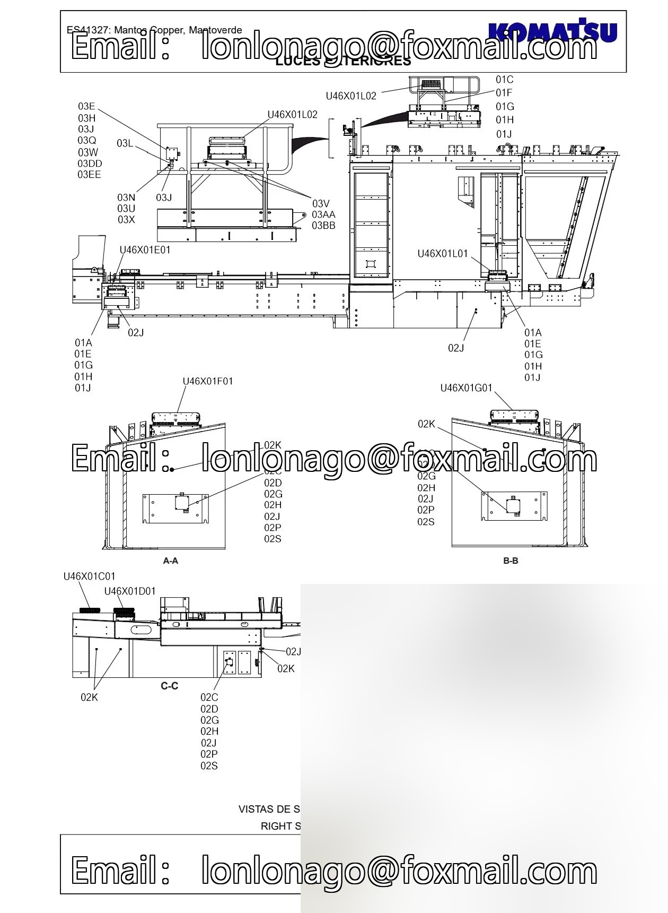

# #Mechanical Aesthetics  #Komatsu Komatsu P&H 4100XPC

## Body

# Mechanical Aesthetics  #Komatsu Komatsu P&H 4100XPC AC AC transmission wire rope electric excavator part catalog
PDF , 1500 pages, comprehensive content, suitable for professional uses such as construction machinery, equipment maintenance, and parts procurement.
refund-free upon sale.
Can be taken directly, and contact privately if there are issues.
Komatsu (Komatsu) P&H 4100XPC AC is a "mining giant beast" level AC transmission wire rope electric excavator specially built for large-scale open-pit mining.
With its remarkable loading capacity and extremely low operating cost, it has become the absolute main force of high-yield mining sites worldwide.

Adaptive Controls (Adaptive Controls): This integrated control function can optimize the performance of the electric shovel, increasing production by up to 9% without damaging the equipment structure, and reduce boom jacking impact up to 50%.

Track Shield (Track Shield): By real-time monitoring the positions and movement trajectories of the shovels, the system can predict potential collisions and intervene in time to effectively protect the track and chassis from damage caused by mis-hits by the shovels.

Comprehensive state monitoring: Supports integration of the Centurion electric control system with the PREVAIL remote state monitoring system, achieving real-time monitoring, performance management, and fault warning for device data, meeting the management needs of modern intelligent mining.

The content covers mechanical aesthetics, including the Komatsu P&H 4100XPC parts catalog, technical data and various material lists, suitable for construction machinery, equipment maintenance and parts procurement.

<!-- AI_ENRICHED -->

## Images

## Payment

Here is a pay link on Stripe ( https://buy.stripe.com/3cs8yP7sY87d0vu9AB ). Please contact me lonlonago@foxmail.com after funding $89, and I will send you a complete data files , thank you!

